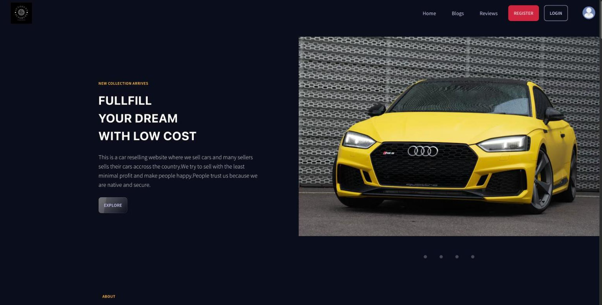

<div align="center">

# AutoHunt

**A used-car marketplace where sellers list cars, buyers pay online, and admins keep it safe.**

<p>
  <a href="https://autohunt-f5b1c.web.app/"><strong>Live site</strong></a> ·
  <a href="https://github.com/Ashikur540/AutoHunt-server">Server repo</a> ·
  <a href="#run-it-locally">Run it locally</a>
</p>

<p>
  
  
  
  
  
</p>



</div>

> **Note:** the live site's API is offline right now, so car listings and
> sign-in do not load. The code runs locally with your own MongoDB and Stripe
> test keys (see below).

## What it does

Buying a second-hand car online is risky: you don't know who the seller is,
and paying a stranger feels unsafe. AutoHunt has three kinds of users, each
with their own dashboard:

- **Buyers** browse cars by category, book one, pay by card through Stripe,
  see their purchases, and report a suspicious listing.
- **Sellers** add cars with photos, see their listings and remove sold ones.
  An admin can mark a seller as **verified**.
- **Admins** see all buyers and sellers, make other users admin, verify
  sellers, delete accounts, and review reported cars.

**Example:** a seller lists a 2018 Corolla. A buyer finds it in its category,
pays through Stripe, and it moves to their purchase list. If something looks
wrong, the buyer reports it, and the admin sees it in **All Reports**.

## How it is built

A MERN app split into two repos: this React client and an
[Express API](https://github.com/Ashikur540/AutoHunt-server).

```
React client (Firebase Hosting)
  ├─ Firebase Auth ─► sign in (email or Google)
  ├─ GET /jwt ──────► API returns a signed token
  └─ fetch + TanStack Query, token in the Authorization header
        │
Express API (Vercel)
  ├─ verifyJWT ─────► every private route
  ├─ verifyAdmin / verifySeller ─► role-only routes
  ├─ MongoDB Atlas ─► users, cars, purchases, reports, reviews
  └─ Stripe ────────► /create-payment-intent, /payments
```

- **Role-based access on both sides**: the client has `PrivateRoute`,
  `AdminRoute` and `SellerRoute`; the server checks the token and the user's
  role from the database, so hiding a button is never the only guard.
- **Payments** use Stripe Payment Intents: the server creates the intent with
  the secret key; the browser only ever sees the publishable key.
- **Data fetching** with TanStack Query, forms with react-hook-form, car
  photos uploaded to imgbb.

| Part   | Tech                                                         |
| ------ | ------------------------------------------------------------ |
| Client | React 18, React Router 6, TanStack Query, Tailwind CSS, daisyUI |
| Auth   | Firebase Authentication + JWT                                |
| Server | Node.js, Express, MongoDB driver                             |
| Payments | Stripe (Payment Intents, React Stripe.js)                  |
| Hosting | Firebase Hosting (client), Vercel (server)                  |

## Run it locally

You need Node.js 18+, a MongoDB Atlas cluster, a Firebase project, a Stripe
account (test mode is fine) and an imgbb API key.

**1. Start the server**

```bash
git clone https://github.com/Ashikur540/AutoHunt-server.git
cd AutoHunt-server
npm install
```

Create `.env`:

```
DB_USER=your-atlas-user
DB_USER_PASS=your-atlas-password
ACCESS_TOKEN_SECRET=any-long-random-string
STRIPE_SECRET=sk_test_...
```

Then run `node index.js`. The API listens on <http://localhost:5000>.

**2. Start the client**

```bash
git clone https://github.com/Ashikur540/AutoHunt-Resell-MarketPlace-Client-.git
cd AutoHunt-Resell-MarketPlace-Client-
npm install
```

Create `.env.local`:

```
REACT_APP_Base_URL=http://localhost:5000
REACT_APP_apiKey=...
REACT_APP_authDomain=...
REACT_APP_projectId=...
REACT_APP_storageBucket=...
REACT_APP_messagingSenderId=...
REACT_APP_appId=...
REACT_APP_imgbb_key=...
```

Then run `npm start` and open <http://localhost:3000>.

## Author

Built by **Ashikur Rahman**, a frontend-focused full-stack developer.
[GitHub](https://github.com/Ashikur540) ·
[LinkedIn](https://linkedin.com/in/md-ashikurrahman)
